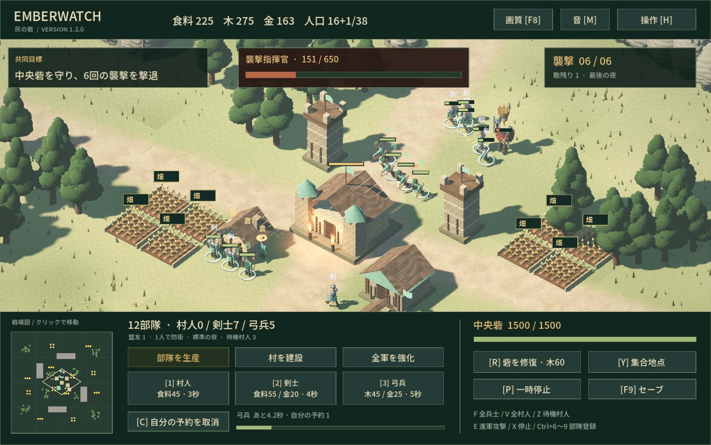
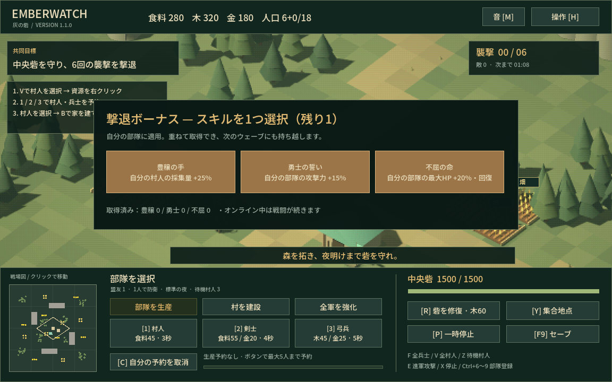

# EMBERWATCH — 灰の砦

PS3世代の表現を目標に、関節のある人物、物理ベースの質感、高解像度・影・空気感を取り入れたGodot製の協力型PvE RTSです。Age of Empiresの「村人で採集し、建物を建て、部隊を率いる」流れを、共同防衛ミッションにまとめています。モデル・地形・音楽・効果音はこのプロジェクト用に生成したオリジナルです。



**VERSION 1.2.0 / Godot 4.5.1 / Windows x64 / 1〜4人協力プレイ / 日本語UI**

[Windows版・編集用ソースのダウンロード（v1.2.0）](https://github.com/jaiaso/emberwatch/releases/tag/v1.2.0)

変更内容は[CHANGELOG](CHANGELOG.md)、動作確認の範囲は[検証結果](docs/verification.md)を参照してください。

## すぐ遊ぶ

Windows版のZIPを展開し、`Emberwatch.exe`をダブルクリックしてください。Godotのインストールは不要です。`Emberwatch.exe`と`Emberwatch.pck`は同じフォルダーに置きます。

タイトル画面で難易度を選び、「ひとりで出陣」で開始できます。初めてなら「穏やかな夜」がおすすめです。標準起動はWindows x64とVulkan対応GPUを想定しています。F8または画質ボタンで高品質/標準を切替。起動できない場合は同梱の「互換モードで起動.cmd」を使えます（OpenGL 3.3、画面効果に制限）。

## 最初の1分

1. **V**で村人3人を選び、近くの木を右クリックして木材を集めます。1人だけ選び直して畑や金鉱を採集させると、別の資源も並行して集められます。
2. **2**で剣士、**3**で弓兵を生産予約します。村人3秒・剣士4秒・弓兵5秒で完成。資源は味方全員で共有します。
3. 村人を選んで**B**、地面をクリックすると家を建てます。家1軒で人口上限が10増えます。
4. **T**で監視塔を建て、**F**で全兵士を選んで防衛位置へ送ります。
5. 標準の初回敵襲は70秒後。以降は前の波を全滅させ、22秒以上の準備時間を挟みます。6回目の敵と指揮官を倒せば勝利です。中央砦が壊れると全員敗北します。撃退時の補給と全軍強化を活用してください。

## v1.2 — 光と鋼

- 人物を立体的な顔・胴・手足・装備に作り直し、歩行・採集・攻撃を関節ごとにアニメーション。
- 石積み、木目、金属、屋根の質感と立体の瓦・基礎・窓枠。陰影はピクセル単位で計算。
- 土と草が混じる地面、風で揺れる草木と旗、表面の粗い岩壁、松明の炎と局所照明。
- 低解像度化と色数制限を廃止。Forward+、4x MSAA、空からの環境光、ACES、SSAO、控えめなグローを導入。
- F8で画質切替。草のMultiMeshと静止部品の材質別結合で描画負荷を軽減。
- PS3世代を目指したオリジナルのスタイライズ表現です。市販AAA作品と同等のアセット量・写実性を保証するものではなく、Windows用のゲームです。

## v1.1 — 峡谷と実り

- マップの一辺を78から118へ拡張（面積約2.29倍）。畑は10から24区画、金鉱は8から18か所へ増設。
- 小麦の畝と明るい金色の鉱石、頭上の「畑・金鉱」表示とミニマップで資源を識別。
- 4つの通行不能な崖。部隊は切れ目を迂回し、崖の上には建築できません。
- 農民は麦わら帽子と道具、剣士は金属鎧と大盾、弓兵は緑の外套と曲がった弓・矢筒。頭上に「農・剣・弓」を表示。帽子・鉱石・装備などのポリゴンと立体部品を増加。
- 各波を撃退すると各プレイヤーにスキル選択権。豊穣の手（自分の村人の採集量+25%）、勇士の誓い（自軍攻撃+15%）、不屈の命（自軍最大HP+20%と同量回復）から1つを選択。重複取得は加算され、新兵にも適用します。最終波後は勝利となります。
- ソロでは選択完了まで次の波を待機。複数人では22秒以上の準備時間中に各自選択。遅れて入った参加者にも撃退済みの選択権を付与します。



## v1.0から継続する機能

- **生産予約と集合地点**：各施設で5人まで予約。人口表示の「+」は予約分です。Cで最後に入れた自分の予約を取り消し、資源を全額返還。Yで新しい部隊の集合地点を指定します。
- **全軍強化**：「全軍を強化」タブ、またはUで攻撃力+25%、Lで中央砦の耐久+500・他の建物+150。現在と今後の味方全員・建物に適用します。
- **部隊操作**：同じ兵種をダブルクリックで選択。Ctrl+6〜9で部隊を登録し、6〜9で呼び出します。Zで待機村人を探せます。
- **ソロの保存**：Pで一時停止、F9で保存、タイトルの「続きから」で再開。襲撃撃退後にも自動保存します。操作説明の表示中はソロだけ一時停止します。
- **戦績と再戦**：勝敗画面で撃破・損失・採集・生産・建築を表示。ホストの「もう一度、出陣」で参加者全員が同じ部屋のまま再戦できます。

## 協力プレイ（1〜4人）

1. ホストが「協力プレイの部屋を作る」を選びます。待機画面に招待用IPが出ます。
2. 同じLANの参加者は、ホストのIPを入力して「部屋に参加」を選びます。同じPCで複数起動する場合は`127.0.0.1`です。
3. ホストが「全員で出陣」を押すと開始します。戦闘中の途中参加も可能です。

**全員がv1.2.0を使用してください。v1.1.0以前とは接続できません。セーブもv1.2用の別ファイルです。** 難易度はホストが部屋を作る前に選択します。オンラインには一時停止・セーブ機能はありません。

各プレイヤーは自分の部隊を指揮し、資源・人口枠・生産施設・中央砦を共有します。敵の数は参加人数に応じて増えます。参加者が離脱すると、その部隊はホストに引き継がれます。ホストが退出すると部屋は終了します。

通信には**UDP 27840**を使います。別のネットワークから直接参加する場合は、ホスト側のルーターのUDPポート転送やファイアウォールの許可が必要になることがあります。自動マッチング、招待コード、NAT越えリレーは実装していません。通信の公開仕様は[Godot公式ドキュメント](https://docs.godotengine.org/en/stable/tutorials/networking/high_level_multiplayer.html)を参照してください。

## 操作

| 操作 | 内容 |
| --- | --- |
| 左クリック / ドラッグ / ダブルクリック | 単体 / 複数 / 画面内の同兵種を選択 |
| Shift + 選択 | 選択を追加。単体なら選択解除も可能 |
| 右クリック | 移動、敵を攻撃、村人で資源を採集 |
| WASD / 矢印 / 中ボタンをドラッグ | カメラ移動 |
| マウスホイール | 拡大・縮小 |
| ミニマップをクリック | カメラをその地点へ移動 |
| Space | 中央砦へカメラを戻す |
| 1 / 2 / 3 / C | 村人 / 剣士 / 弓兵を予約 / 自分の予約を取消 |
| B / N / T | 家 / 兵舎 / 監視塔を設置 |
| E → 地面をクリック | 敵を迎撃しながら進軍 |
| X | 選択中の部隊を停止 |
| F / V | 自分の全兵士 / 全村人を選択 |
| Z | 待機村人を選択し、カメラを移動 |
| Ctrl+6〜9 / 6〜9 | 部隊を登録 / 呼び出し |
| Y → 地面をクリック | 新兵の集合地点を指定 |
| U / L | 武器 / 建物を強化 |
| P / F9 | ソロを一時停止 / セーブ |
| R | 木材60で砦の耐久を220修復 |
| G | カーソル位置を全員に合図 |
| H / Esc | 操作説明。建築・進軍指定中は取消 |
| M | BGMと効果音の消音切替 |

建築は選択した村人から14マス以内です。近づいた村人が工事を進めます。複数人で作業すると早く完成します。監視塔は完成すると自動で周囲を攻撃します。村人は同じ資源の近くの採集場所へ自動で切り替えます。共有の生産施設が複数あれば、予約の少ない施設へ自動で割り当てます。

## 収録内容と範囲

- 固定マップ1つ、3資源、村人・剣士・弓兵、家・兵舎・監視塔、4種類の敵、6ウェーブ、3難易度。
- 日本語UI、ミニマップ、複数選択、進軍攻撃、共同修復、合図、BGM・効果音。
- ホストが20Hzで戦闘を計算し、10Hzで圧縮した状態を送信。UDPの大きなパケットを避けるため900バイト単位で分割し、順序が前後しても復元します。操作権と資源消費もホストが検証します。
- 文明の選択、時代進化、霧、キャンペーン、ゲームパッド操作は含まれていません。移動は建物・崖のA*経路探索と部隊の近隣回避を使います。インターネット越しの実機プレイやゲームバランスの長期検証は未実施です。
- PS3世代の表現を目指した**PC向け**ゲームです。

## Godotで編集する

Godot **4.5.1**で`project.godot`を読み込み、F6ではなく**F5**で実行します。追加のアドオンは不要です。3Dモデルは`visuals.gd`、ルールは`simulation.gd`、ネットワークは`session.gd`、操作とカメラは`game.gd`、画面は`hud.gd`です。

Windows向けの再書き出しには、Godot 4.5.1のエクスポートテンプレートをインストールし、`Windows Desktop`プリセットを使用してください。

```powershell
godot --headless --path . --script res://tests/simulation_test.gd
godot --headless --path . --script res://tests/ui_test.gd
godot --headless --path . --script res://tests/save_test.gd
godot --headless --path . --script res://tests/match_test.gd
```

4人の通信テストは、同じプロジェクトを4プロセスで起動し、`res://tests/network_test.gd`に`-- host`または`-- c1`、`-- c2`、`-- c3`を渡します。ホストを先に起動してください。

途中参加・再戦・離脱の検証は`res://tests/lifecycle_test.gd`を使い、`-- host`・`-- early`・`-- late`の3プロセスを順番に起動します。`late`は`early`の2秒後に起動します。セーブテストは既存のセーブ内容を退避して復元します。

## クレジット

Godot Engine 4.5.1（MIT）、Noto Sans JP（SIL Open Font License 1.1）を使用しています。ライセンス本文は、ソース版では`licenses`と`assets/OFL.txt`、Windows版では同梱の`GODOT-*.txt`と`NOTO-FONT-LICENSE.txt`に収録しています。Age of Empiresのコード・画像・音源は使用していません。
