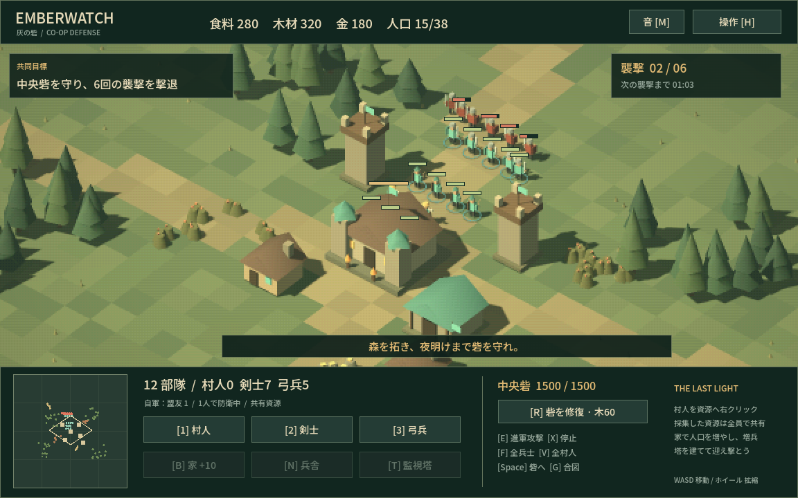

# EMBERWATCH — 灰の砦

PS1時代を思わせるローポリゴン、粗い画面、落ち着いた色で作った、Godot製の協力型PvE RTS試作です。Age of Empiresの「村人で採集し、建物を建て、部隊を率いる」流れを、小さな共同防衛ミッションにまとめています。モデル・地形・音楽・効果音はこのプロジェクト用に生成したオリジナルです。



**Godot 4.5.1 / Windows x64 / 1〜4人協力プレイ / 日本語UI**

変更内容は[CHANGELOG](CHANGELOG.md)、動作確認の範囲は[検証結果](docs/verification.md)を参照してください。

## すぐ遊ぶ

Windows版のZIPを展開し、`Emberwatch.exe`をダブルクリックしてください。Godotのインストールは不要です。`Emberwatch.exe`と`Emberwatch.pck`は同じフォルダーに置きます。

タイトル画面の「ひとりで出陣」で開始できます。Windows x64、OpenGL 3.3対応のGPUを想定しています。

## 最初の1分

1. **V**で村人3人を選び、近くの木を右クリックして木材を集めます。1人だけ選び直して果実や金鉱を採集させると、別の資源も並行して集められます。
2. **2**で剣士、**3**で弓兵を増やします。資源は味方全員で共有します。
3. 村人を選んで**B**、地面をクリックすると家を建てます。家1軒で人口上限が10増えます。
4. **T**で監視塔を建て、**F**で全兵士を選んで防衛位置へ送ります。
5. 最初の敵襲は70秒後。6回目の襲撃まで敵を倒し切れば勝利です。中央砦が壊れると全員敗北します。

## 協力プレイ（1〜4人）

1. ホストが「協力プレイの部屋を作る」を選びます。待機画面に招待用IPが出ます。
2. 同じLANの参加者は、ホストのIPを入力して「部屋に参加」を選びます。同じPCで複数起動する場合は`127.0.0.1`です。
3. ホストが「全員で出陣」を押すと開始します。戦闘中の途中参加も可能です。

各プレイヤーは自分の部隊を指揮し、資源・人口枠・生産施設・中央砦を共有します。敵の数は参加人数に応じて増えます。参加者が離脱すると、その部隊はホストに引き継がれます。ホストが退出すると部屋は終了します。

通信には**UDP 27840**を使います。別のネットワークから直接参加する場合は、ホスト側のルーターのUDPポート転送やファイアウォールの許可が必要になることがあります。自動マッチング、招待コード、NAT越えリレーは実装していません。通信の公開仕様は[Godot公式ドキュメント](https://docs.godotengine.org/en/stable/tutorials/networking/high_level_multiplayer.html)を参照してください。

## 操作

| 操作 | 内容 |
| --- | --- |
| 左クリック / ドラッグ | 自分の部隊を単体 / 複数選択 |
| Shift + 選択 | 選択を追加。単体なら選択解除も可能 |
| 右クリック | 移動、敵を攻撃、村人で資源を採集 |
| WASD / 矢印 | カメラ移動 |
| マウスホイール | 拡大・縮小 |
| ミニマップをクリック | カメラをその地点へ移動 |
| Space | 中央砦へカメラを戻す |
| 1 / 2 / 3 | 村人 / 剣士 / 弓兵を生産 |
| B / N / T | 家 / 兵舎 / 監視塔を設置 |
| E → 地面をクリック | 敵を迎撃しながら進軍 |
| X | 選択中の部隊を停止 |
| F / V | 自分の全兵士 / 全村人を選択 |
| R | 木材60で砦の耐久を220修復 |
| G | カーソル位置を全員に合図 |
| H / Esc | 操作説明。建築・進軍指定中は取消 |
| M | BGMと効果音の消音切替 |

建築は選択した村人から14マス以内です。近づいた村人が工事を進めます。複数人で作業すると早く完成します。監視塔は完成すると自動で周囲を攻撃します。村人は同じ資源の近くの採集場所へ自動で切り替えます。生産施設には1.5秒の再使用待ち時間があります。

## 収録内容と試作の範囲

- 固定マップ1つ、3資源、村人・剣士・弓兵、家・兵舎・監視塔、2種類の敵、6ウェーブ。
- 日本語UI、ミニマップ、複数選択、進軍攻撃、共同修復、合図、BGM・効果音。
- ホストが20Hzで戦闘を計算し、10Hzで圧縮した状態を送信。UDPの大きなパケットを避けるため900バイト単位で分割し、順序が前後しても復元します。操作権と資源消費もホストが検証します。
- 文明の選択、時代進化、研究、霧、セーブ、キャンペーン、ゲームパッド操作は未実装です。移動は開けた地形向けの簡易回避方式です。インターネット越しの実機プレイやゲームバランスの長期検証は未実施です。
- PS1風の見た目を目指した**PC向け**試作です。

## Godotで編集する

Godot **4.5.1**で`project.godot`を読み込み、F6ではなく**F5**で実行します。追加のアドオンは不要です。3Dモデルは`visuals.gd`、ルールは`simulation.gd`、ネットワークは`session.gd`、操作とカメラは`game.gd`、画面は`hud.gd`です。

Windows向けの再書き出しには、Godot 4.5.1のエクスポートテンプレートをインストールし、`Windows Desktop`プリセットを使用してください。

```powershell
godot --headless --path . --script res://tests/simulation_test.gd
godot --headless --path . --script res://tests/ui_test.gd
```

4人の通信テストは、同じプロジェクトを4プロセスで起動し、`res://tests/network_test.gd`に`-- host`または`-- c1`、`-- c2`、`-- c3`を渡します。ホストを先に起動してください。

## クレジット

Godot Engine 4.5.1（MIT）、Noto Sans JP（SIL Open Font License 1.1）を使用しています。ライセンス本文は、ソース版では`licenses`と`assets/OFL.txt`、Windows版では同梱の`GODOT-*.txt`と`NOTO-FONT-LICENSE.txt`に収録しています。Age of Empiresのコード・画像・音源は使用していません。
