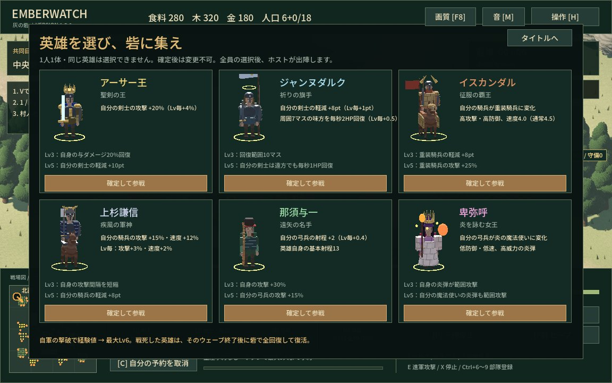

# 六人の英雄

ソロは「ひとりで出陣」の後、協力プレイは部屋に入った後に英雄を確定します。1人1体、同じ英雄は同じ部屋で選べません。同時に選んだ場合もホストが先に受理した1人だけに確定します。協力プレイは全員の選択後にホストが出陣。確定後の変更はできません。再戦では全員が選び直します。途中参加者は空いている英雄を選び、Lv1から参戦します。

英雄は砦の近くに初期配置され、通常部隊と同じ左クリック・ドラッグ・右クリックで指揮できます。**Q**または画面左の英雄ボタンで自分の英雄を選択して視点移動。Fの全兵士選択にも含まれます。英雄は生産できず、通常の人口枠を消費しません。金色の足元リング、名前・レベル表示、ミニマップの金色のひし形が目印です。

## 初期能力と外見

軽減は被ダメージを減らす割合です。速度・射程はゲーム内のマスを基準とします。

| 英雄 | HP | 攻撃 | 軽減 | 速度 | 射程 | 特別な装備 |
| --- | ---: | ---: | ---: | ---: | ---: | --- |
| アーサー王 | 340 | 30 | 50% | 2.9 | 1.8 | 金の王冠、輝く聖剣、青いマント |
| ジャンヌダルク | 360 | 17 | 55% | 2.8 | 1.8 | 白い旗、光輪、白いマントと鎧 |
| イスカンダル | 360 | 32 | 42% | 4.0 | 2.0 | 角飾りの兜、赤いマント、金属の馬鎧と旗 |
| 上杉謙信 | 260 | 32 | 25% | 5.3 | 2.0 | 前立ての兜、白い頭巾、紺の鎧、軍旗 |
| 那須与一 | 180 | 25 | 10% | 2.7 | 13.0 | 烏帽子、赤い鉢巻、大弓、緑の外套 |
| 卑弥呼 | 160 | 46 | 0% | 2.0 | 10.0 | 金の冠、白い祭服、浮遊する炎と光の珠 |

## 経験値・成長・復活

経験値は**自分の英雄・部隊・自分が建てた塔による敵の撃破**で獲得します。守備隊も対象。通常兵・投石兵15、巨兵45、指揮官240。味方プレイヤーの撃破では獲得せず、距離制限はありません。英雄の戦死中も自軍の撃破で経験値を得られます。

| レベル | 必要な累計経験値 | 共通効果 |
| --- | ---: | --- |
| 1 | 0 | 初期能力とパッシブ |
| 2 | 60 | 英雄の最大HP +8%・攻撃 +10% |
| 3 | 160 | 英雄の最大HP +16%・攻撃 +20%、固有効果解放 |
| 4 | 300 | 英雄の最大HP +24%・攻撃 +30% |
| 5 | 480 | 英雄の最大HP +32%・攻撃 +40%、固有効果解放 |
| 6 | 700 | 英雄の最大HP +40%・攻撃 +50%（最大） |

増加率は初期値からの加算です。最大HPが増えた分だけ現在HPも回復します。ウェーブ報酬の「勇士」「不屈」や全軍研究も適用されます。

戦死後はそのウェーブの敵が全滅すると、砦の近くで全回復して復活します。経験値・レベルは維持。準備中の遠征で戦死した場合は次のウェーブの撃退後に復活します。砦が破壊された場合は復活しません。

## 固有効果

「自分の」は同じプレイヤーが所有する通常部隊を指します。現在の部隊と新兵の両方に適用。英雄自身には表の共通成長と固有の英雄効果が適用されます。配下の能力上昇・兵種変更は英雄の戦死中も継続し、ジャンヌの周囲回復はジャンヌの生存中だけ働きます。

| 英雄 | 初期パッシブ・兵種変更 | Lv3 | Lv5 |
| --- | --- | --- | --- |
| アーサー王 | 自分の剣士の攻撃+20%、以後Lv毎+4% | 自身の実際の与ダメージの20%を回復 | 自分の剣士の軽減+10ポイント |
| ジャンヌダルク | 自分の剣士の軽減+8ポイント、以後Lv毎+1ポイント。周囲7マスの味方を毎秒2HP回復、以後Lv毎+0.5HP | 回復範囲が10マスに拡大 | 自分の剣士は範囲外でも毎秒1HP回復 |
| イスカンダル | 自分の騎兵が重装騎兵になる | 重装騎兵の軽減+8ポイント | 重装騎兵の攻撃+25% |
| 上杉謙信 | 自分の騎兵の攻撃+15%・速度+12%、以後Lv毎に攻撃+3%・速度+2% | 自身の攻撃間隔0.85→0.65秒 | 自分の騎兵の軽減+8ポイント |
| 那須与一 | 自分の弓兵の射程+2、以後Lv毎+0.4マス | 自身の攻撃+30% | 自分の弓兵の攻撃+15% |
| 卑弥呼 | 自分の弓兵が炎の魔法使いになる | 自身の炎弾が周囲2.4マスの敵にも35%の威力で命中 | 魔法使いの炎弾も周囲1.8マスの敵に25%の威力で命中 |

ジャンヌの周囲回復は味方プレイヤー・英雄・村人にも適用し、被弾直後でも働きます。敵や戦死者は対象外。Lv5の自分の剣士への回復は周囲回復と加算されます。炎の範囲攻撃は敵だけに命中します。

| 兵種 | HP | 攻撃 | 軽減 | 速度 | 射程 | 攻撃間隔 | 生産コスト・時間 |
| --- | ---: | ---: | ---: | ---: | ---: | ---: | --- |
| 重装騎兵 | 180 | 23 | 35% | 4.0 | 1.9 | 0.85秒 | 食料110・金70・30秒 |
| 魔法使い | 55 | 28 | 0% | 2.1 | 8.0 | 1.35秒 | 木45・金25・22秒 |

兵種変更は初期部隊と以後の生産の両方に適用します。ボタン・キーは騎兵4、弓兵3のままです。卑弥呼自身の攻撃間隔は1.25秒。通常兵種の生産コストと生産時間を引き継ぎます。
